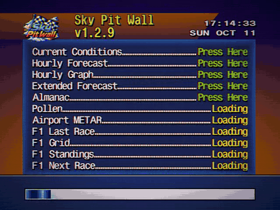

# Sky Pit Wall

Weather, aviation and Formula 1 on a TV, in the style of The Weather Channel's WeatherStar 4000 from the 1990s.

<div align="center">
    
</div>

<p align="center"><em>One rotation in 4:3 with scan lines, vignette and colour fringe, three seconds per screen (sample location: Lisbon; the screens that only work on the Raspberry Pi are left out).</em></p>

**Live version:** https://hmirpereira.github.io/Sky-Pit-Wall

Sky Pit Wall is a personal project. It runs full screen on a 1080p TV from a Raspberry Pi 3 (DietPi, Chromium in kiosk mode, widescreen, 24-hour clock), with background music. It started as a fork of [WeatherStar 4000+ International](https://github.com/mwood77/ws4kp-international) and keeps its engine, fonts and look; the screens, data sources and much of the rest are its own. See [Credits](#credits-and-licence).

## Contents

- [Screens](#screens)
- [Weather screens](#weather-screens)
- [Aviation screens](#aviation-screens)
- [Formula 1 screens](#formula-1-screens)
- [Look and feel](#look-and-feel)
- [Settings and the TV address](#settings-and-the-tv-address)
- [The Raspberry Pi side](#the-raspberry-pi-side)
- [Development](#development)
- [Fixes to the original](#fixes-to-the-original)
- [Credits and licence](#credits-and-licence)

## Screens

In rotation order. "Pi" means the screen only works on the Raspberry Pi and is skipped anywhere else.

| Screen | What it shows | Source |
|---|---|---|
| Hazards | IPMA warnings for one Portuguese district (in Portuguese); skipped when there are none | [IPMA](https://api.ipma.pt) |
| Current Conditions | Temperature, sky, wind, humidity, pressure and more | [Open-Meteo](https://open-meteo.com) |
| Hourly Forecast, Hourly Graph | The next 24 hours, as a list and as a graph | Open-Meteo |
| Travel Forecast | Five European cities, high and low | Open-Meteo |
| Regional Forecast | Portugal: district and island capitals on five maps | Open-Meteo; maps from [Natural Earth](https://www.naturalearthdata.com) |
| Extended Forecast, Almanac | The next days; sun and moon | Open-Meteo |
| Local Radar | Precipitation radar | [RainViewer](https://www.rainviewer.com) |
| Air Quality, Pollen | Air quality index; daily pollen levels | Open-Meteo (CAMS) |
| Airport METAR | METAR of one airport decoded into plain English, then its TAF (Pi) | [metar.vatsim.net](https://metar.vatsim.net); TAF from [aviationweather.gov](https://aviationweather.gov) |
| Departures (Pi) | Next departures of a list of airlines from one airport | [AeroDataBox](https://aerodatabox.com) |
| Cancellations (Pi) | Cancelled departures from the same airport, all airlines | AeroDataBox |
| Overhead (Pi) | Closest aircraft, a 50 km radar and the airport plan with the aircraft on the ground | Own ADS-B receiver, [adsb.lol](https://adsb.lol), [adsbdb](https://www.adsbdb.com), [OpenStreetMap](https://www.openstreetmap.org) |
| Work Schedule (Pi) | Shifts for the next 7 days, with the weather at those times | Private spreadsheet, kept on the Pi |
| F1 Last Race | Podium and fastest lap of the latest Grand Prix or sprint | [Jolpica F1](https://github.com/jolpica/jolpica-f1), [OpenF1](https://openf1.org) |
| F1 Grid | Starting order of the next sprint or race | Jolpica F1, OpenF1 |
| F1 Drivers | Drivers' championship, scrolling through the field | Jolpica F1 |
| F1 Next Race | Track, details and countdown; weekend schedule and race forecast | Jolpica F1, [f1-circuits](https://github.com/bacinger/f1-circuits), Open-Meteo |

Every screen can be switched on or off on the page. Latest Observations, Local Forecast, Marine Forecast and Personal Weather Station are kept from the original but are off on the TV.

## Weather screens

- **Hazards**: yellow, orange and red warnings from IPMA (the Portuguese weather service) for the district chosen in the settings, kept in Portuguese on purpose and without accents (the Star4000 fonts have none). Skipped when there are none or no district is set. In widescreen the warning colour fills the whole width.
- **Travel Forecast**: the cities in `TRAVEL_CITIES` (`travelforecast.mjs`, today Frankfurt, Munich, Zurich, Geneva and Vienna) in one Open-Meteo request; after 18:00 it shows tomorrow. Five cities fit on one screen without scrolling.
- **Regional Forecast**: the original used the US National Weather Service and a US map, so it never worked outside the USA. Here it shows the 18 Portuguese district capitals and the island capitals (Ponta Delgada, Angra, Horta, Funchal) on five maps (North, Centre, Lisbon, South, Islands), 6 seconds each. Each label sits on its city, without dots or lines. Today's forecast until 18:00, then tomorrow's, in one Open-Meteo request. The maps and label positions come from a generator script (not in this repository) using Natural Earth 1:10m (public domain): `images/regional-pt-*.png` and `utils/regional-pt.mjs`.
- **Pollen**: daily average from Open-Meteo / CAMS (Europe only), with the US National Allergy Bureau levels as a guide.

## Aviation screens

Navy and silver, with yellow flight numbers. Apart from the METAR, they read their data from a small service on the Raspberry Pi (see [The Raspberry Pi side](#the-raspberry-pi-side)).

- **Airport METAR**: the METAR of the airport set on the page, decoded into plain English (wind, visibility, weather, clouds, temperature, humidity, pressure, trend). Busy reports are split into pages; the raw report is shown when there is room. On the Pi, the airport's TAF follows on its own pages: issue time, then each change group (Becoming, Temporary, Prob 30%, From) with its period in Portuguese time. aviationweather.gov does not accept browser requests, so the TAF comes through the Pi (`/taf.json`) and is left out anywhere else.
- **Departures**: next departures from the airport set on the Pi, for the airlines set there, with a tail icon, estimated time and status (ON TIME, DELAYED, CANCELLED, or SCHEDULED when there is no live data). Codeshares are left out; a delay counts from 15 minutes. The Pi calls the AeroDataBox FIDS API with a private key and spreads the monthly quota over the days left.
- **Cancellations**: today's cancelled departures from the same airport, all airlines: flight, destination and scheduled time (a `?` marks a cancellation AeroDataBox is not sure about). It reuses the Departures responses, so it costs no extra calls; the footer shows when the list was last refreshed.
- **Overhead**: aircraft around home, from the owner's ADS-B receiver (tar1090/readsb), completed by the open adsb.lol network; routes from adsbdb by callsign. Metric units throughout. Up to three pages, 12 seconds each:
  - **Closest Now**: the closest aircraft in the air: flight number, airline, route, distance and direction from home, altitude with a climbing or descending mark, speed, type and registration. A route is shown only if the aircraft is near the line between its origin and destination (adsbdb routes are by callsign and sometimes out of date); otherwise "Route unknown".
  - **Within 50 km**: radar with rings at 10, 25 and 50 km, home as a dot and the airport's name. Each aircraft is an arrow with its flight number and, under it, the route (e.g. FRA-ZRH), with the airline's logo above when there is one. Labels never overlap each other, the arrows or the ring numbers. A list by distance sits beside it.
  - **Ground**: the airport plan, turned so the main runway lies across the screen, with a north mark: runways, taxiways with their letters, aprons, buildings and stand numbers where they fit. Aircraft on the ground show the stand or taxiway they are on; aircraft landing or taking off are in yellow. The group's aircraft (the airlines of the Departures screen, by callsign) stay in grey on their stand, with their last flight number, after switching the transponder off, until the same aircraft (same ICAO address) shows up again, another aircraft parks on that stand, or 36 hours pass. A list in the empty corner under the runway shows the group's aircraft on a stand and when they arrived.
  - Flight numbers (LH1176) come from callsigns made of the airline code and digits (DLH1176); callsigns with letters (RYR10UB) do not give the flight number, so the callsign is shown.
  - The airport plan is made from OpenStreetMap data (ODbL, credited on screen) by a script (not in this repository) and kept on the Pi with the home position, so no place is written in the code.
- **Work Schedule**: two pages. Shifts for the next 7 days with the weather at the start of each; then the next (or current) shift with a countdown and the weather at its start and end. The schedule is a private spreadsheet that a job on the Pi copies from cloud storage (read only) every hour; it never leaves the Pi.

## Formula 1 screens

Red and black.

- **F1 Last Race**: the latest Grand Prix or sprint ("F1 Last Sprint") with flag and date, a podium with team icons, the winner's time and the gaps for 2nd and 3rd, and the fastest lap.
- **F1 Grid**: the starting order of the next sprint or race in two staggered columns, like a real grid, scrolling through the field. It is the qualifying classification, so grid penalties are not included. Pole shows its lap time and the others the gap to it, from the last part of qualifying each driver reached ("No time" if they set none there).
- **Weekend timing** (`utils/f1-weekend.mjs`): the two screens take turns. After sprint qualifying, sprint grid until the sprint; after the sprint, sprint result until qualifying; after qualifying, race grid until the race; after the race, race result until the next weekend starts. Results are asked for shortly after each session, then every 20 minutes until they appear, and once more at the next F1 update time to catch penalties.
- **Sources**: Jolpica F1 first (its alpha API for sprint qualifying); OpenF1 when Jolpica has not published a session yet, which can take until after the weekend (`utils/f1-openf1.mjs`).
- **F1 Drivers**: the whole drivers' championship, 7 rows at a time, scrolling like the original Travel Forecast, with a team icon per driver (each driver's current team comes from the latest race).
- **F1 Next Race**: page 1 has the track outline, Grand Prix, circuit, place with an 8-bit flag, track length, date and countdown; page 2 has the weekend schedule in Portuguese time and the forecast at the circuit for the start of the race (from 15 days before). Outlines are in `utils/f1-circuits.mjs`.
- **Update rule** (`utils/f1-update.mjs`): F1 Drivers and F1 Next Race download their data once a day from Friday to Monday after 22:00 (Lisbon time) and keep it in `localStorage` the rest of the week.

## Look and feel

- **Logo**: `images/skypitwalllogo.png` (340 x 268) in the header of every screen, `images/skypitwalllogo-large.png` (680 x 536) on the loading screen and `images/Logo192.png` as the browser and app icon, all made from the owner's high resolution drawing.
- **Themes**: recoloured copies of the WeatherStar backgrounds for the F1 screens (red and black, `_f1-theme.scss`) and the aviation screens (navy and silver, `_aviation-theme.scss`). Colours only; no Formula 1 or airline marks.
- **Icons**, drawn by the owner of this project: `images/airlines/<IATA code>.png` (airline tails, 128 x 128), `images/teams/<constructorId>.png` (F1 teams, 128 x 128) and `images/overhead-logos/<ICAO code>.png` (airline logos for the radar, 48 x 16, listed in `RADAR_LOGOS` in `overhead.mjs`; `LOGO_ALIASES` maps other callsign prefixes of the same brand). `images/flags/<country>.png` are 24 x 16 pixel flags scaled up without smoothing. A missing icon or flag is simply not shown.
- **Accents**: the Star4000 fonts draw accented letters blank, so accents are removed from names (F1 screens, Cancellations, Hazards).
- **Analogue look** (`_scan-lines.scss`), each a setting of its own and all static, so they cost the Pi almost nothing:
  - **Scan lines**: on the TV (kiosk mode) they are drawn over the whole window in real pixels, one dark line every two (540 lines at 1080p). Drawn inside the 640 x 480 screen, as in the original, the 2.25x scale made them 2 or 3 pixels thick and uneven.
  - **Vignette**: darker corners, like a picture tube.
  - **Colour fringe on text**: red and blue edges on the text, like a VHS recording, through the shared `text-shadow` mixin (`--fringe-left`, `--fringe-right`).
  - **Colour fringe on pictures**: the red and blue channels of the pictures pulled apart by an SVG filter in `index.ejs` (`#vhs-rgb`). Not on the radar, which animates.
- **Music**: the page's Winamp plays *The Weather Channel Presents: The Best of Smooth Jazz*, streamed from the [Internet Archive](https://archive.org/details/the-weather-channel-presents-the-best-of-smooth-jazz-full-album). On the TV the Winamp is hidden and the Pi plays its own music.

## Settings and the TV address

The settings panel on the page holds:

- **Local airport and IPMA area**: airport ICAO code, airport name and IPMA warning area, carried in the address as `settings-airportIcao-text`, `settings-airportName-text` and `settings-ipmaArea-select`. Nothing is set by default, so no place is written in the code: without them the Airport METAR and Hazards screens are skipped. The airport name goes into the titles ("<name> Airport", "<name> Departures").
- **Units, hours format and speed**.
- **Display options**: Hide Webamp, Kiosk, Enable Scan Lines, Enable Vignette, Enable Colour Fringe on Text (VHS), Enable Colour Fringe on Pictures (VHS), Widescreen.

Every choice on the page goes into the address, so a whole setup is one link. **Copy TV command** (TV panel) copies `skypitwall-tv url '<address>'` with the screens and settings chosen on the page, plus kiosk, widescreen, scan lines and no Winamp. On the Pi, that command replaces the browser address, keeps the previous one and restarts the browser. Kiosk mode can also be added to any link with `&kiosk=true`.

## The Raspberry Pi side

The Pi-only screens read their data from services on the Pi that are not in this repository, because they hold private keys, the home position and personal data:

- `skypitwall-voos` serves `http://127.0.0.1:8095/`: `flights.json` and `cancelled.json` (AeroDataBox), `taf.json` (aviationweather.gov), `overhead.json` (ADS-B receiver, adsb.lol, adsbdb, airport plan), `schedule.json` and `health.json`.
- `skypitwall-horario` turns the private schedule spreadsheet into JSON for the Work Schedule screen.

Chromium on the Pi lets the public site read the local service through the `LocalNetworkAccessAllowedForUrls` and `LoopbackNetworkAllowedForUrls` policies. Anywhere else those requests fail and the screens are skipped.

**Pi warnings**: when something on the Pi stops updating (flight data refused or failing, flight quota low, TAF or schedule stale, ADS-B receiver down), its screen is skipped, so the bottom line adds a short red warning such as `Schedule stale since Tue 14:07` (`utils/pi-health.mjs`, checked every 5 minutes). Nothing is shown when all is well or off the Pi.

## Development

You need Node.js. Run it locally:

```
npm install
npm run start
```

and open http://localhost:8080/.

**Updating the live site**: edit the sources, run `npm run build:css` and `npm run build`, and commit the `docs/` folder together with the sources. GitHub Pages serves `docs/` from `main`. The Pi only loads new code when Chromium restarts.

To replace an icon, flag or the logo without building, put the new file with the same name in both `server/images/...` and `docs/images/...` (otherwise the next build brings the old one back). GitHub Pages lets browsers cache images for 10 minutes.

**Layout**: views in `views/` (EJS), one module per screen in `server/scripts/modules/`, styles in `server/styles/scss/`. Each screen is a `WeatherDisplay` subclass registered with `registerDisplay`; the build list is in `gulp/build-gh-pages.mjs`.

**Version**: Sky Pit Wall has its own version number in `package.json`, starting at 1.0.0 (10 October 2026; forked from WeatherStar 4000+ International 12.1.0). It is shown on the loading screen and is the cache-buster of the script, style and icon links, so each release raises it: the last number for fixes, the middle one for new screens or features.

## Fixes to the original

- Auto refresh never started when a display stayed in "loading" (e.g. Hazards) or after a failed data request.
- The Hazards screen was never hidden, which stalled the rotation as soon as there was a warning.
- "Last Update" always showed "(none)".
- Missing weather icons: fog, freezing drizzle and rain, hail and violent rain showers.
- Times follow the "Hours Format" setting everywhere (Hourly Forecast, Almanac, Radar, Local Forecast text).
- The GPS (current location) button still expected a reply from the US weather service (NOAA) and stalled; it now turns the coordinates into a place name (ArcGIS reverse geocoding) and asks to type a city when the browser gives no position.
- The menu button with no location chosen drew the progress screen under the start screen; it now focuses the search box.
- METAR to weather code conversion for personal weather stations (test order and codes).
- Experimental Features removed (the nearby-cities lookup for Air Quality and Local Radar and its third-party proxy): slow, unreliable and of little use in Portugal.
- Webamp pinned to a fixed version instead of `@next`; image preloads resolve relative to the page.
- The loading screen lists only the screens that are switched on, in smaller lines when there are many.
- Browser icon and web app manifest: the icon link carries the version, and the manifest paths are relative to the site.

## Credits and licence

- Built on [WeatherStar 4000+ International](https://github.com/mwood77/ws4kp-international) by [@mwood77](https://github.com/mwood77), itself based on [ws4kp](https://github.com/netbymatt/ws4kp) by [@netbymatt](https://github.com/netbymatt) and the original project by [Mike Battaglia](https://github.com/vbguyny/ws4kp), who wrote the code that draws the weather displays and the background graphics.
- Fonts and weather icons from [TWCClassics](https://twcclassics.com/downloads.html): fonts by Nick Smith; icons by Charles Abel, Nick Smith and Malek Masoud.
- Track outlines from [bacinger/f1-circuits](https://github.com/bacinger/f1-circuits), MIT License, Copyright (c) 2019-2025 Tomislav Bacinger.
- Map data: [Natural Earth](https://www.naturalearthdata.com) (public domain); airport plans (c) OpenStreetMap contributors, [ODbL](https://opendatacommons.org/licenses/odbl/).
- Data: Open-Meteo, IPMA, RainViewer, metar.vatsim.net, aviationweather.gov, Jolpica F1, OpenF1, AeroDataBox, adsb.lol, adsbdb.
- Licence: MIT, as the projects it is built on; see [LICENSE](LICENSE).

**Disclaimer**: this is a personal, non-commercial project. Do not rely on it in dangerous weather or for flight operations; the data can be late, wrong or missing. The WeatherSTAR 4000 belongs to The Weather Channel. Sky Pit Wall is not affiliated with The Weather Channel, Formula 1, the FIA, the Lufthansa Group or any team or airline; their names and marks belong to their owners.
