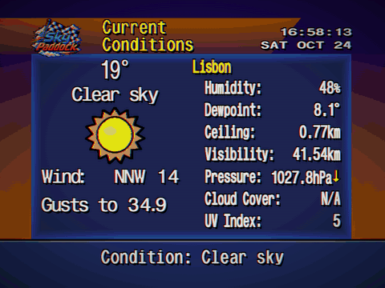

# Sky Paddock

Weather, aviation and Formula 1 on a TV, in the style of The Weather Channel's WeatherStar 4000 from the 1990s.

<div align="center">
    
</div>

<p align="center"><em>One rotation in 4:3 with scan lines, vignette and colour fringe, three seconds per screen (sample location: Lisbon; the screens that only work on the Raspberry Pi are left out).</em></p>

**Live version:** https://hmirpereira.github.io/Sky-Paddock

Sky Paddock is a personal project. It runs full screen on a 1080p TV from a Raspberry Pi 3 (DietPi, Chromium in kiosk mode, widescreen, 24-hour clock), with background music. It started as a fork of [WeatherStar 4000+ International](https://github.com/mwood77/ws4kp-international) and keeps its engine, fonts and look; the screens, data sources and much of the rest are its own. See [Credits](#credits-and-licence).

## Contents

- [Screens](#screens)
- [Settings and the TV address](#settings-and-the-tv-address)
- [The Raspberry Pi side](#the-raspberry-pi-side)
- [Development](#development)
- [Credits and licence](#credits-and-licence)

More detail lives in `docs-src/`:

- Screens: [Weather](docs-src/screens/weather.md), [Aviation](docs-src/screens/aviation.md), [Formula 1](docs-src/screens/formula-1.md), [GT World](docs-src/screens/gt-world.md), [News](docs-src/screens/news.md), [Plex](docs-src/screens/plex.md)
- [Look and feel](docs-src/look-and-feel.md): the page, scrolling, bottom bar, themes, icons, analogue look, Debug mode, Status, display options, Dark Mode, Christmas and Halloween Effects
- [Sources and limits](docs-src/sources.md): every outside source, how often it is asked, its limits and what happens when it refuses
- [Development](docs-src/development.md): running, testing and publishing in full
- [Fixes to the original](docs-src/fixes-to-the-original.md)
- [CHANGELOG](CHANGELOG.md): one line per version

## Screens

In rotation order. "Pi" means the screen only works on the Raspberry Pi and is skipped anywhere else.

| Screen | What it shows | Source |
|---|---|---|
| Hazards | IPMA warnings for one Portuguese district (in Portuguese); skipped when there are none | [IPMA](https://api.ipma.pt) |
| Current Conditions | Temperature, sky, wind, humidity, pressure and more | [Open-Meteo](https://open-meteo.com) |
| Hourly Forecast, Hourly Graph | The next 24 hours, as a list and as a graph (temperature line with its highest and lowest marked, cloud cover line, precipitation chance as bars, a yellow "now" edge and the weekday after midnight) | Open-Meteo |
| Travel Forecast | Page 1: five European cities, high and low. Page 2: current weather and local time of one city chosen in the settings (Montreal by default) | Open-Meteo |
| Regional Forecast | Portugal: district and island capitals on six maps | Open-Meteo; maps from [Esri](https://www.esri.com) tiles; coast lines from [Natural Earth](https://www.naturalearthdata.com) |
| Extended Forecast, Almanac | The next days; sun and moon | Open-Meteo |
| Local Radar | Precipitation radar | [RainViewer](https://www.rainviewer.com) |
| Air & Pollen | European Air Quality Index now and daily pollen levels, on one screen | Open-Meteo (CAMS) |
| Work Schedule (Pi) | Shifts for the next 7 days, with the weather at those times; the day's gates with staff, stand and ETA | Private spreadsheets, kept on the Pi; stand and ETA from TAP's public FLIC pages for OPO |
| Departures (Pi) | Next departures of a list of airlines from one airport | [AeroDataBox](https://aerodatabox.com) |
| Cancellations (Pi) | Cancelled departures from the same airport, all airlines | AeroDataBox |
| Overhead (Pi) | Closest aircraft, a 50 km radar and the airport plan with the aircraft on the ground | Own ADS-B receiver, [adsb.fi](https://adsb.fi), [adsb.lol](https://adsb.lol) (backup), [OpenSky](https://opensky-network.org), [adsbdb](https://www.adsbdb.com), [OpenStreetMap](https://www.openstreetmap.org) |
| Airport METAR | METAR of one airport decoded into plain English, then its TAF (Pi) | [metar.vatsim.net](https://metar.vatsim.net); TAF from [aviationweather.gov](https://aviationweather.gov) |
| News (Pi) | Latest Portuguese headlines, breaking and top stories first, each with its source's logo; then a page of aviation news and a last page with Formula 1 news; breaking news can also crawl in the bottom line | RSS feeds of [RTP](https://www.rtp.pt/noticias), [Expresso](https://expresso.pt), [Publico](https://www.publico.pt), [CNN Portugal](https://cnnportugal.iol.pt), for aviation [Aviacao TV](https://aviacao.tv) and, for F1, [FlyingLapF1](https://flyinglapf1.com), [F1PT](https://www.f1pt.pt) and [PlanetF1](https://www.planetf1.com) |
| Plex Recommends (Pi) | Two pages: the movie added most recently to the Plex library and an unwatched movie picked at random, each with its poster, title, year, runtime, Rotten Tomatoes scores (critics and audience) and synopsis | [Tautulli](https://tautulli.com) (connected to Plex) |
| Plex Now Playing (Pi) | What is playing on the Plex server now, one page per session (3 at most): poster, title (with season, episode and name for a series), playing or paused, who is watching and on which device, a progress bar with the time played and when it ends, and the synopsis. Skipped when nothing is playing | Tautulli |
| F1 Last Race | Podium and fastest lap of the latest Grand Prix or sprint | [Jolpica F1](https://github.com/jolpica/jolpica-f1), [OpenF1](https://openf1.org) |
| F1 Photo (Pi) | One random picture an hour from the top of r/F1Porn, with the title of the post under it | [r/F1Porn](https://www.reddit.com/r/F1Porn/) (public feed) |
| F1 Grid | Starting order of the next sprint or race | Jolpica F1, OpenF1 |
| F1 Telemetry | The two fastest laps of the latest practice or qualifying: times, the track coloured by who was faster where, and speed along the lap | OpenF1 |
| F1 Drivers | Drivers' championship, scrolling through the field | Jolpica F1 |
| F1 Next Race | Track, details and countdown; weekend schedule and race forecast | Jolpica F1, [f1-circuits](https://github.com/bacinger/f1-circuits), Open-Meteo |
| Verstappen Jet (Pi) | Where Max Verstappen's jet is and its last flight, with a map of the route | [adsb.fi](https://adsb.fi) (ADS-B), OpenSky, [OurAirports](https://ourairports.com), [Celebplanes](https://www.celebplanes.com) (missing airports, once a day), Natural Earth |
| GT World (Pi) | Result of the latest GT World Challenge Europe race(s), with Verstappen's team always shown | Public pages of [gt-world-challenge-europe.com](https://www.gt-world-challenge-europe.com) |
| GT World Next (Pi) | Next GT World Challenge Europe event: track outline, round, cup, country with flag, length and turns, race date, countdown, weekend timetable and race forecast | Public event pages of [gt-world-challenge-europe.com](https://www.gt-world-challenge-europe.com), Open-Meteo |

Every screen can be switched on or off on the page. How often each source is asked and what limits it has: [Sources and limits](docs-src/sources.md).

## Settings and the TV address

Every choice on the page goes into the address, so a whole setup is one link. **Copy TV command** (TV and link tab) copies `skypaddock-tv url '<address>'` with the screens and settings chosen on the page, plus kiosk, widescreen, scan lines and the version mark. On the Pi, that command replaces the browser address, keeps the previous one and restarts the browser. Kiosk mode can also be added to any link with `&kiosk=true`.

See [Look and feel](docs-src/look-and-feel.md) for the page, the settings and the display options.

## The Raspberry Pi side

The Pi-only screens read their data from services on the Pi that are not in this repository, because they hold private keys, the home position and personal data:

- `skypaddock-hub` (the Pi's data service, called `skypaddock-voos` until 1.5.0; one core file plus `hub_*.py` modules for the news, Plex, GT World, airport and F1 photo data since 30 October 2026) serves `http://127.0.0.1:8095/`: `flights.json` and `cancelled.json` (AeroDataBox), `taf.json` (aviationweather.gov), `overhead.json` (ADS-B receiver, adsb.lol, OpenSky for the aircraft on the ground at the airport, adsbdb, airport plan), `f1jet.json` (adsb.lol, OurAirports), `news.json` (Portuguese RSS feeds), `schedule.json`, `health.json`, and `beat` and `kiosk.json` for the kiosk watchdog.
- `skypaddock-horario` turns the private schedule spreadsheet into JSON for the Work Schedule screen.

Chromium on the Pi lets the public site read the local service through the `LocalNetworkAccessAllowedForUrls` and `LoopbackNetworkAllowedForUrls` policies. Anywhere else those requests fail and the screens are skipped.

**Kiosk watchdog**: in kiosk mode the page tells the Pi service each time the rotation moves to another screen, at most once a minute (`utils/pi-heartbeat.mjs`). A timer on the Pi (`skypaddock-kiosk`) restarts the browser when there has been no sign of life for 6 minutes (a blank page after a power cut, a frozen page or one that never loaded), unless the TV was switched off on purpose, the internet is down (a restart would not help) or it already restarted in the last 10 minutes (at most 3 times an hour). Each restart is written to a log on the SD card with the reason.

**Pi warnings**: when something on the Pi stops updating (flight data refused or failing, flight quota low, TAF or schedule stale, ADS-B receiver, OpenSky or Plex down), its screen is skipped, so the bottom line adds a short red warning such as `Schedule stale since Tue 14:07` (`utils/pi-health.mjs`, checked every 5 minutes). Nothing is shown when all is well or off the Pi.


## Development

You need Node.js.

```
npm install
npm run dev
```

Open http://localhost:8080/ (Vite: changes to the code and the styles show at once). `npm run preview` builds and serves the finished site.

- `npm run lint`, `npm run build` and `npm run test:unit` before every change goes up; `npm test` runs the Playwright smoke test of every screen after a build.
- To publish, push to `main`: GitHub Actions lints, builds, tests and deploys to GitHub Pages, and publishes nothing if a step fails.
- Sky Paddock has its own version number in `package.json` (the last number for fixes, the middle one for new screens or features); add the version to the [CHANGELOG](CHANGELOG.md).

The whole story (requests and retries, the tests, text from other sites, layout, versions) is in [Development](docs-src/development.md).

## Credits and licence

- Built on [WeatherStar 4000+ International](https://github.com/mwood77/ws4kp-international) by [@mwood77](https://github.com/mwood77), itself based on [ws4kp](https://github.com/netbymatt/ws4kp) by [@netbymatt](https://github.com/netbymatt) and the original project by [Mike Battaglia](https://github.com/vbguyny/ws4kp), who wrote the code that draws the weather displays and the background graphics.
- Fonts and weather icons from [TWCClassics](https://twcclassics.com/downloads.html): fonts by Nick Smith; icons by Charles Abel, Nick Smith and Malek Masoud.
- Track outlines from [bacinger/f1-circuits](https://github.com/bacinger/f1-circuits), MIT License, Copyright (c) 2019-2025 Tomislav Bacinger. Lap records and corner names (`utils/circuit-facts.mjs`) are facts taken from public sources such as Wikipedia, not copied text. The positions of the start lines and corners were checked against [tobi/track-atlas](https://github.com/tobi/track-atlas) (geometry from OpenStreetMap contributors, ODbL; corner data from Lovely-Sim-Racing); none of its data is included, only our own measurements of where things are on our outlines.
- Map data: [Natural Earth](https://www.naturalearthdata.com) (public domain); airport plans (c) OpenStreetMap contributors, [ODbL](https://opendatacommons.org/licenses/odbl/).
- Data: Open-Meteo, IPMA, RainViewer, metar.vatsim.net, aviationweather.gov, Jolpica F1, OpenF1, RTP, Expresso, Publico, CNN Portugal, Aviacao TV, FlyingLapF1, F1PT, PlanetF1, Tautulli and Plex, gt-world-challenge-europe.com, AeroDataBox, adsb.fi, airplanes.live, adsb.lol, The OpenSky Network, adsbdb, OurAirports.
- Licence: MIT, as the projects it is built on; see [LICENSE](LICENSE).

**Disclaimer**: this is a personal, non-commercial project. Do not rely on it in dangerous weather or for flight operations; the data can be late, wrong or missing. The WeatherSTAR 4000 belongs to The Weather Channel. Sky Paddock is not affiliated with The Weather Channel, Formula 1, the FIA, the Lufthansa Group, Max Verstappen or any team or airline; their names and marks (including the MV logo) belong to their owners.

