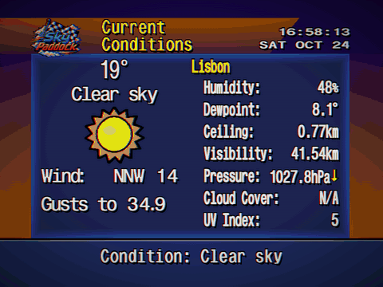

# Sky Paddock

Weather, aviation and Formula 1 on a TV, in the style of The Weather Channel's WeatherStar 4000 from the 1990s.

<div align="center">
    
</div>

<p align="center"><em>One rotation in 4:3 with scan lines, vignette and colour fringe, three seconds per screen (sample location: Lisbon; the screens that only work on the Raspberry Pi are left out).</em></p>

**Live version:** https://hmirpereira.github.io/Sky-Paddock

Sky Paddock is a personal project. It runs full screen on a 1080p TV from a Raspberry Pi 3 (DietPi, Chromium in kiosk mode, widescreen, 24-hour clock), with background music. It started as a fork of [WeatherStar 4000+ International](https://github.com/mwood77/ws4kp-international) and keeps its engine, fonts and look; the screens, data sources and much of the rest are its own. See [Credits](#credits-and-licence). Until version 1.3 it was called Sky Pit Wall.

## Contents

- [Screens](#screens)
- [Weather screens](#weather-screens)
- [Aviation screens](#aviation-screens)
- [Formula 1 screens](#formula-1-screens)
- [GT World](#gt-world)
- [News](#news)
- [Plex](#plex)
- [Look and feel](#look-and-feel)
- [Settings and the TV address](#settings-and-the-tv-address)
- [The Raspberry Pi side](#the-raspberry-pi-side)
- [Development](#development)
- [Fixes to the original](#fixes-to-the-original)
- [Credits and licence](#credits-and-licence)

## Screens

In rotation order. "Pi" means the screen only works on the Raspberry Pi and is skipped anywhere else.

| Screen | What it shows | Source |
|---|---|---|
| Hazards | IPMA warnings for one Portuguese district (in Portuguese); skipped when there are none | [IPMA](https://api.ipma.pt) |
| Current Conditions | Temperature, sky, wind, humidity, pressure and more | [Open-Meteo](https://open-meteo.com) |
| Hourly Forecast, Hourly Graph | The next 24 hours, as a list and as a graph (temperature line with its highest and lowest marked, cloud cover line, precipitation chance as bars, a yellow "now" edge and the weekday after midnight) | Open-Meteo |
| Travel Forecast | Page 1: five European cities, high and low. Page 2: current weather and local time of one city chosen in the settings (Montreal by default) | Open-Meteo |
| Regional Forecast | Portugal: district and island capitals on five maps | Open-Meteo; maps from [Natural Earth](https://www.naturalearthdata.com) |
| Extended Forecast, Almanac | The next days; sun and moon | Open-Meteo |
| Local Radar | Precipitation radar | [RainViewer](https://www.rainviewer.com) |
| Air & Pollen | European Air Quality Index now and daily pollen levels, on one screen | Open-Meteo (CAMS) |
| Work Schedule (Pi) | Shifts for the next 7 days, with the weather at those times | Private spreadsheet, kept on the Pi |
| Airport METAR | METAR of one airport decoded into plain English, then its TAF (Pi) | [metar.vatsim.net](https://metar.vatsim.net); TAF from [aviationweather.gov](https://aviationweather.gov) |
| Departures (Pi) | Next departures of a list of airlines from one airport | [AeroDataBox](https://aerodatabox.com) |
| Cancellations (Pi) | Cancelled departures from the same airport, all airlines | AeroDataBox |
| Overhead (Pi) | Closest aircraft, a 50 km radar and the airport plan with the aircraft on the ground | Own ADS-B receiver, [adsb.lol](https://adsb.lol), [OpenSky](https://opensky-network.org), [adsbdb](https://www.adsbdb.com), [OpenStreetMap](https://www.openstreetmap.org) |
| News (Pi) | Latest Portuguese headlines, breaking and top stories first, each with its source's logo; a last page with Formula 1 news; breaking news can also crawl in the bottom line | RSS feeds of [RTP](https://www.rtp.pt/noticias), [Expresso](https://expresso.pt), [Publico](https://www.publico.pt), [CNN Portugal](https://cnnportugal.iol.pt), [Sabado](https://www.sabado.pt) and, for F1, [FlyingLapF1](https://flyinglapf1.com), [F1PT](https://www.f1pt.pt) and [PlanetF1](https://www.planetf1.com) |
| Plex Recommends (Pi) | Two pages: the movie added most recently to the Plex library and an unwatched movie picked at random, each with its poster, title, year, runtime, Rotten Tomatoes scores (critics and audience) and synopsis | [Tautulli](https://tautulli.com) (connected to Plex) |
| F1 Last Race | Podium and fastest lap of the latest Grand Prix or sprint | [Jolpica F1](https://github.com/jolpica/jolpica-f1), [OpenF1](https://openf1.org) |
| F1 Grid | Starting order of the next sprint or race | Jolpica F1, OpenF1 |
| F1 Telemetry | The two fastest laps of the latest practice or qualifying: times, the track coloured by who was faster where, and speed along the lap | OpenF1 |
| F1 Drivers | Drivers' championship, scrolling through the field | Jolpica F1 |
| F1 Next Race | Track, details and countdown; weekend schedule and race forecast | Jolpica F1, [f1-circuits](https://github.com/bacinger/f1-circuits), Open-Meteo |
| F1 Jet (Pi) | Where Max Verstappen's jet is and its last flight, with a map of the route | [adsb.lol](https://adsb.lol) (ADS-B, ODbL), OpenSky, [OurAirports](https://ourairports.com), Natural Earth |
| GT World (Pi) | Result of the latest GT World Challenge Europe race(s), with Verstappen's team always shown | Public pages of [gt-world-challenge-europe.com](https://www.gt-world-challenge-europe.com) |
| GT World Next (Pi) | Next GT World Challenge Europe event: track outline, round, cup, country with flag, length and turns, race date, countdown, weekend timetable and race forecast | Public event pages of [gt-world-challenge-europe.com](https://www.gt-world-challenge-europe.com), Open-Meteo |

Every screen can be switched on or off on the page. Marine Forecast is kept from the original but is off on the TV. Removed from the original: Latest Observations and the United States city and station lists (1.5.5), the Personal Weather Station screen with its Express server and Docker files (1.6.1), the Local Forecast text screen (1.10.1).

## Weather screens

- **Hazards**: yellow, orange and red warnings from IPMA (the Portuguese weather service) for the district chosen in the settings, kept in Portuguese on purpose and without accents (the Star4000 fonts have none). Skipped when there are none or no district is set. In widescreen the warning colour fills the whole width.
- **Travel Forecast**: two pages of 10 seconds, no scrolling. Page 1: the cities in `TRAVEL_CITIES` (`utils/travel-cities.mjs`, today Frankfurt, Munich, Zurich, Geneva and Vienna) in one Open-Meteo request; after 18:00 it shows tomorrow. Page 2, laid out as Current Conditions and inside the same box: temperature, condition and icon, wind and gusts, then the city with the 8-bit flag of its country and its local time, feels like, humidity, dewpoint, visibility, pressure (with the rising or falling arrow) and cloud cover now (your units), of the city chosen with **Travel Forecast city** in the settings (a list grouped by continent, "-- Europe --" and "-- North America --", each in alphabetical order, as "London - United Kingdom"), from 30 European and Canadian cities in `DETAIL_CITIES` (same file, none of them on page 1; Montreal by default). If one page has no data the other is shown alone.
- **Regional Forecast**: the original used the US National Weather Service and a US map, so it never worked outside the USA. Here it shows the 18 Portuguese district capitals and the island capitals (Ponta Delgada, Angra, Horta, Funchal) on five maps (North, Centre, Lisbon, South, Islands), 6 seconds each. Each label sits on its city, without dots or lines. Today's forecast until 18:00, then tomorrow's, in one Open-Meteo request. The maps and label positions come from a generator script (not in this repository) using Natural Earth 1:10m (public domain): `images/regional-pt-*.png` and `utils/regional-pt.mjs`.
- **Air & Pollen**: on the left, a dial with the European Air Quality Index for the current hour (0 to 150, the bands in the colours of the European Environment Agency, the number and the band in the middle); on the right, the daily pollen averages from Open-Meteo / CAMS (Europe only) as a level and four steps, with the US National Allergy Bureau scales as a guide. One request for both; until 1.6 the air quality had a screen of its own (US index). Outside Europe only the air quality is shown.

## Aviation screens

Navy and silver, with yellow flight numbers. Apart from the METAR, they read their data from a small service on the Raspberry Pi (see [The Raspberry Pi side](#the-raspberry-pi-side)).

- **Airport METAR**: the METAR of the airport set on the page, decoded into plain English (wind, visibility, weather, clouds, temperature, humidity, pressure, trend). Busy reports are split into pages (the page number, 1/3, is at the bottom right, not in the title); the raw report is shown when there is room. On the Pi, the airport's TAF follows on its own pages: issue time, then each change group (Becoming, Temporary, Prob 30%, From) with its period in Portuguese time. aviationweather.gov does not accept browser requests, so the TAF comes through the Pi (`/taf.json`) and is left out anywhere else.
- **Departures**: next departures from the airport set on the Pi, for the airlines set there, with a tail icon, estimated time and status (ON TIME, DELAYED, CANCELLED, or SCHEDULED when there is no live data). Codeshares are left out; a delay counts from 15 minutes. The Pi calls the AeroDataBox FIDS API with a private key and spreads the monthly quota over the days left.
- **Cancellations**: today's cancelled departures from the same airport, all airlines: flight, destination and scheduled time (a `?` marks a cancellation AeroDataBox is not sure about). It reuses the Departures responses, so it costs no extra calls; the bottom bar shows when the list was last refreshed.
- **Overhead**: aircraft around home, from the owner's ADS-B receiver (tar1090/readsb), completed by the open adsb.lol network (asked every 5 minutes: the API allows 500 requests a day per address, shared with the F1 Jet screen) and, for the aircraft on the ground at the airport, The OpenSky Network (which the other two cannot hear); routes from adsbdb by callsign. Metric units throughout. Up to three pages, 12 seconds each:
  - **Closest Now**: the closest aircraft in the air: flight number, airline, route, distance and direction from home, altitude with a climbing or descending mark, speed, type and registration. A route is shown only if the aircraft is near the line between its origin and destination (adsbdb routes are by callsign and sometimes out of date); otherwise "Route unknown".
  - **Within 50 km**: radar with rings at 10, 25 and 50 km, home as a dot and the airport's name. Each aircraft is a plane (the owner's picture, `images/overhead-plane.png`: Lufthansa in its own colours, the others its shape in sky blue, the closest in yellow, parked ones in grey) pointing where it flies, with its flight number and, under it, the route (e.g. FRA-ZRH), with the airline's logo above when there is one. Labels never overlap each other, the arrows or the ring numbers. A list by distance sits beside it.
  - **Ground**: the airport plan, turned so the main runway lies across the screen, with a north mark: runways, taxiways with their letters, aprons, buildings and stand numbers where they fit. Aircraft on the ground show the stand or taxiway they are on; aircraft landing or taking off are in yellow. The group's aircraft (the airlines of the Departures screen, by callsign) stay in grey on their stand, with their last flight number, after switching the transponder off, until the same aircraft (same ICAO address) shows up again, another aircraft parks on that stand, or 36 hours pass. A list in the empty corner under the runway shows the group's aircraft on a stand and when they arrived.
  - Flight numbers (LH1176) come from callsigns made of the airline code and digits (DLH1176). For the group's airlines, whose callsigns often have letters (DLH4AB), the Pi service matches the callsign, or else the aircraft (ICAO address or registration), with the arrivals and departures it already gets from AeroDataBox for the Departures screen (the same request now asks for both), so parked aircraft show the flight they arrived with. Other callsigns with letters (RYR10UB) do not give the flight number, so the callsign is shown.
  - The airport plan is made from OpenStreetMap data (ODbL, credited on screen) by a script (not in this repository) and kept on the Pi with the home position, so no place is written in the code.
- **Work Schedule**: two pages. Shifts for the next 7 days with the weather at the start of each; then the next (or current) shift with a countdown and the weather at its start and end. The schedule is a private spreadsheet that a job on the Pi copies from cloud storage (read only) every hour; it never leaves the Pi. When the spreadsheet also has the "(R)" sheets of the months (same layout as the others), the (R) schedule of each day is shown in small under the shift, start and end of that day (the day column keeps its big text; the other columns get smaller to make room, and the rows have alternating bands). The option **Personal Schedule** (On by default) turns it off: with Off, or without the (R) sheets, every column has the big text in the whole height of the row, as before.

## Formula 1 screens

- **Titles**: the word F1 in the titles (F1 Drivers, F1 Next Race, F1 Telemetry, F1 Race and Sprint Grid, F1 Last Race and Last Sprint, and the F1 News page) is the Formula 1 logo, supplied by the owner, without the TM mark: white on the F1 screens (`images/f1-logo.svg`), in its own red on the F1 News page, whose title is just "F1 News" in one line (`images/f1-logo-red.svg`; `utils/f1-title.mjs`).
Red and black.

- **F1 Last Race**: the latest Grand Prix or sprint ("F1 Last Sprint") with flag and date, a podium with team icons, the winner's time and the gaps for 2nd and 3rd, and the fastest lap.
- **F1 Grid**: the starting order of the next sprint or race in two staggered columns, like a real grid, scrolling through the field. It is the qualifying classification, so grid penalties are not included. Pole shows its lap time and the others the gap to it, from the last part of qualifying each driver reached ("No time" if they set none there).
- **Weekend timing** (`utils/f1-weekend.mjs`): the two screens take turns. After sprint qualifying, sprint grid until the sprint; after the sprint, sprint result until qualifying; after qualifying, race grid until the race; after the race, race result until the next weekend starts. Results are asked for shortly after each session, then every 20 minutes until they appear, and once more at the next F1 update time to catch penalties.
- **Sources**: Jolpica F1 first (its alpha API for sprint qualifying); OpenF1 when Jolpica has not published a session yet, which can take until after the weekend (`utils/f1-openf1.mjs`).
- **F1 Drivers**: the whole drivers' championship, 7 rows at a time, scrolling like the original Travel Forecast, with a team icon per driver (each driver's current team comes from the latest race).
- **F1 Next Race**: skipped when the race has no dated session yet. Page 1 has the track outline, Grand Prix, circuit, place with an 8-bit flag, track length, date and countdown; page 2 has the weekend schedule in Portuguese time and the forecast at the circuit for the start of the race (from 15 days before). Outlines are in `utils/f1-circuits.mjs`. Every circuit has its lap record ("TRACK RECORD": time, driver, year) in place of the circuit name, and the circuits whose corners or sections have a name also get a dot and the name on the outline (Spa, Monaco, Monza, Silverstone, Suzuka, Zandvoort, Mexico City, Montreal, Interlagos); a corner with no name is not marked, not even with its number, and there is no start line or arrow (their positions could not be verified). All of it lives in `utils/circuit-facts.mjs`, written by hand from public sources (the race lap record as in the Wikipedia article of the circuit, to be checked each season); the position of each corner was checked against the real positions on the circuit (the outlines agree with them to 2 to 9 m). Madring, Sepang, Istanbul and Portimao only have the record. `utils/circuit-view.mjs` sizes the map so the names always fit.
- **F1 Telemetry**: the best laps of the two fastest drivers in the latest practice or qualifying session (sprint qualifying included), from OpenF1's car data (speed about 4 times a second) and positions. Page 1: lap number, lap time, gap and sector times (the faster sector on a chip of the driver's colour), the 25 mini-sectors as a strip in lap order and how many each driver won, and the track drawn from the fastest driver's positions, each mini-sector in the colour of the driver who was faster there, with the start line, the direction of the lap and the S2 and S3 lines. Page 2: speed along the lap for both, and under it the gap between them along the lap (filled in the colour of the driver ahead), with the sector lines. The distance along the lap comes from integrating the speed, so both laps are put on the same scale, and the second lap is stretched piece by piece so its sector lines fall where the fastest lap's do: the gap is exact at the sector lines and the end, and approximate between them; small differences in the line taken are ignored. The screen looks for a newer session at most once an hour, 30 minutes after a session ends (OpenF1 refuses free requests while a session is live), and keeps the latest result in `localStorage`. Driver colours are the team colours from OpenF1, made lighter when needed to read on the red background; when both are close (same team, or teams with similar colours) the second driver gets a lighter tint. All F1 screens ask OpenF1 through one queue (`utils/f1-openf1.mjs`), one request at a time and spaced, because it refuses requests that come too close together (429). The screen is skipped three days after the end of the weekend it is about (the latest session of the same meeting, the race usually), and shows again with the next weekend's first practice.
- **F1 Jet**: Max Verstappen's private jet (PH-UTL, a Falcon 8X, ICAO address 4867E6). Page 1: a boarding pass of the last flight (three-letter airport codes such as TZX-NCE, cities, times in Lisbon, duration and date), with the MV logo on the route line at the jet's place and a lion in the background (both supplied by the owner of this project), and where the jet is now (how long it has been on the ground, or altitude and speed in the air). Page 2: a map of that flight's route from its ADS-B positions, with the two airports; while flying, a dot marks the jet. The Pi service asks the open adsb.lol network for the jet once an hour (that API allows 500 requests a day per address, shared with the Overhead screen, and answers 429 with the seconds to wait, which the service respects). The track files of adsb.lol, which gave the route of the last hours, are now behind a verification page for anything but a browser; that is not worked around, they are asked again only every 6 hours, and the route comes from The OpenSky Network. A flight is a stretch in the air between two stretches on the ground, and its airports are the nearest ones (within 12 km, from a monthly copy of OurAirports) to the ground points or to the low points of the climb and descent; when OpenSky loses the jet (over the Atlantic, for instance) and gives no arrival airport, the arrival is the airport nearest to the end of the route or, after landing, to where the jet is seen on the ground (within 24 h of take-off), and the landing time is the first sighting there. When none of that gives the arrival (OpenSky loses the jet over Mexico or the Atlantic and adsb.lol does not see it on the ground), the Pi service asks AeroDataBox for the jet's flights by registration and takes the arrival airport and time of the one that left at the same time (from the flight plan): one request per flight, a second one 3 hours later if there was no answer, only for flights of the last 3 days, counted in the same monthly quota as Departures. If OpenSky later sees the real landing, its airport wins. Flights older than about a day come from The OpenSky Network with the owner's free account (flights by aircraft, worked out overnight, and their tracks; checked at start-up up to 30 days back and then every 6 hours); without a track the map shows a straight line between the two airports. The last flight is kept on the Pi. It serves `f1jet.json`. Until version 1.3 the data came from F1 Jet Tracker, which now lets only its own site read its files. The world map is Natural Earth 1:10m simplified into `utils/world-map.mjs` by a script (not in this repository).
- **Update rule** (`utils/f1-update.mjs`): F1 Drivers and F1 Next Race download their data once a day from Friday to Monday after 22:00 (Lisbon time) and keep it in `localStorage` the rest of the week.

## GT World

- **GT World** (Pi): the result of the latest GT World Challenge Europe race, one page per race (two on a sprint weekend): event, dates and the first eight with car number, drivers, team and gap. The highlighted team's car(s), Verstappen's team by default (`GT_HIGHLIGHT` on the Pi), are marked in red in the list; a car that finished further down takes the last row, after a dashed line. A team with a logo shows it instead of the name (always; there is no option for it any more), on a dark badge (only Verstappen's team, from an SVG supplied by the owner, in `server/images/gt-teams/`, listed in `utils/gt-team-logos.mjs`). There is no API: the Pi service reads the public results pages of the official site (the same form the site uses, by season, event and session) and the calendar for the dates, every 6 hours, every 30 minutes from Friday to Monday, and serves `gt.json`. If the site changes its pages, the screen is skipped.
- **GT World Next** (Pi): the next event, or the current one during the weekend, laid out like F1 Next Race. The screen is skipped when the event has no dated session yet (a next-year event announced without dates). Page 1 has the track outline, event, cup (Sprint or Endurance), country with an 8-bit flag, track length and number of turns, race date and countdown; page 2 has the timetable in Portuguese time (the last six sessions on a busy weekend) and the forecast at the circuit for the start of the race (from 15 days before). The Pi service takes the first event of the calendar that has not ended and reads its event page (round, length, turns and the timetable in GMT). Outlines and positions are in `utils/gt-circuits.mjs` (`ferramentas/mkgtcircuits.py`); they are the Grand Prix layouts, and Brands Hatch and Misano have no outline, so the details use the whole width there.
- Both GT screens use the charcoal and red of the official site: `_gt-theme.scss` and the backgrounds `BackGround1_1_gt.png` / `BackGround1_1_wide_gt.png` (`recolor_theme.py gt`).

## News

- **News** (Pi): the Pi service reads the RSS feeds of RTP, Expresso, Publico, CNN Portugal and Sabado every 10 minutes (conditional requests, so an unchanged feed is not downloaded again) and serves `news.json` with the headlines of the last 12 hours. The same story from several sources is shown once (headlines that share enough words, within 6 hours). **Breaking**: the source marks the headline as "Ultima hora" or "Urgente", in the last 2 hours. **Top story**: the same story in 3 or more of the 4 sources in the last 3 hours. Both come first. Opinion, podcasts and match reports are left out. Three headlines per page, up to four pages; the Star4000 fonts have no accents, so they are removed. Each headline and the bottom of the screen show the source by its logo (at the bottom, the general sources and the F1 ones are parted by a short vertical line) (`images/news/`, from the owner's files; `utils/news.mjs`), on a small white plate (RTP, Expresso, Publico, CNN Portugal), a black one (FlyingLapF1, F1PT) or a red one in the red of Sabado's own box, so all logos have the same margins and size. Expresso's programmes, interviews, podcasts and satire (Inimigo Publico) and Sabado's photo galleries are left out by their categories.
- **F1 News** (last page of News): the latest Formula 1 headlines of [FlyingLapF1](https://flyinglapf1.com) and [F1PT](https://www.f1pt.pt) (both Portuguese) and [PlanetF1](https://www.planetf1.com) (English, `https://www.planetf1.com/rss`, about ten a day), up to three from the last 7 days, at most two from each so no source takes all the places (the Pi service keeps two from each source, the screen then shows the three most recent); the same story in two sources is shown once. They are kept apart from the other sources so they are not joined to general stories; podcast episodes (items with audio) are left out. With F1 news the other headlines take at most three pages.
- **Bottom line**: with *Show Breaking News in the Bottom Line* on, each round of the bottom line ends with the breaking news (at most two), with a red BREAKING label (the source is only on the News screen): shown from the start for 3 seconds, then crawling slowly to the left, within the same margins as the weather lines, until the end has been read, and staying another 3.5 seconds. Without breaking news nothing is added.
- Only headlines, with their source, are shown; nothing is stored on disk.

## Plex

- **Plex Recommends** (Pi): two pages of 15 seconds, off by default. The title is "Plex Recommends" in one line on both: the Plex logo (supplied by the owner, `images/plex/plex-logo.svg`, its black parts made white to show on the velvet) in place of the word, then "Recommends". It looks like a cinema: red velvet on the header band and where the WeatherStar orange was (`BackGround1_1_cinema.png`, `recolor_theme.py cinema`), a dark auditorium for the box with a row of still marquee bulbs along its top (nothing is animated, for the Pi), a gold frame on the poster and gold and cream letters. Page 1: the movie added most recently to the Plex library. Page 2: a movie chosen at random from those with no plays, one that is not the latest and not the one shown before when there are others. Each page has the poster on the left and, beside it, the title, year and runtime, the two Rotten Tomatoes scores, each with the picture of its verdict (the Tomatometer of the critics with a ripe or a rotten tomato, the audience score with upright or spilled popcorn; pictures supplied by the owner, in `images/plex/`; the verdict is the one Plex gives, or 60 % when it gives none; a score is left out when it is not from Rotten Tomatoes, never an IMDb or TMDb score under its name) and the synopsis, cut at a word where the box ends. The bottom bar has only the page counter (1/2): no source, it is Plex.
- **How it works**: the Pi service asks [Tautulli](https://tautulli.com) (on the Raspy5, connected to the Plex server) every 30 minutes (every 5 after a failure) for the latest movie (`get_recently_added`), the movies of the libraries with no plays (`get_library_media_info`), the details of the two chosen (`get_metadata`) and their posters (`pms_image_proxy`), and serves `plex.json` and the two posters (`plex-poster-latest.jpg`, `plex-poster-random.jpg`, kept in memory only). The screen is skipped when the service has nothing, which is also what happens anywhere but the Pi. "No plays" is what Tautulli reports for the library; a movie watched outside Plex, or on a server Tautulli does not follow, still counts as unwatched.
- **Setting it up** (in the Pi's `/etc/skypaddock-hub.conf`, never in this repository): `TAUTULLI_KEY` (the API key of Tautulli; without it the screen is off), `TAUTULLI_URL` (default `http://raspy5:8181`) and `TAUTULLI_SECTIONS` (the numbers of the movie libraries to use, separated by commas; empty means every movie library). The key is only sent to Tautulli, never to the page, and is left out of the errors and the log. The Pi warning line adds `Plex stale since ...` when the data is more than 3 hours old.

## Look and feel

- **The page** (around the screen; not shown on the TV): it follows the window. On a phone everything is in one column; from 700 px the panels are in two columns under the screen; from 1100 px the screen is on the left, as big as the window allows (`resize` in `navigation.mjs`), and the panels are in a column of their own on the right that scrolls by itself, so the options are always in view; from 1600 px that column has two columns of panels (`_site.scss`).
- **Scrolling**: a screen that scrolls (Hourly Forecast, Hazards, F1 Drivers, F1 Grid) scrolls its whole box, so the background stripes move with the text, as in the Hourly Forecast; the column headers or the race title stay at the top. This is the way for any new screen that scrolls: extend `ScrollWeatherDisplay` (`scrollweatherdisplay.mjs`), put the rows in and call `setScrollDistance` with the height that does not fit; the time on screen is 3 s still, the scroll at 50 px/s and 3 s still (`utils/scroll-timing.mjs`), so it follows the number of rows (the idea comes from the original WeatherStar 4000+, [ws4kp](https://github.com/netbymatt/ws4kp)). The whole scroll is one screen of the rotation, so the Next and Previous buttons skip the whole screen.
- **Bottom bar (sources and pages)**: where a screen shows its source (Departures, Cancellations, METAR and TAF, F1 Telemetry, F1 Jet, GT World) it is a line at the bottom of the box, always still, centred, on the background of the screen and at half opacity (`views/partials/footer.ejs`, `_source-footer.scss`, `utils/footer.mjs`). A screen with several pages shows the page counter (1/3) at the bottom right of that bar, never in the title. Only News has a bar of its own colour, because its sources are logos (left) and the counter is at the right. The map credit on the Overhead plan stays on the map, as the OpenStreetMap licence asks.
- **Loading screen**: the list of screens with their state; with more than 11 it goes into two columns by group (Weather, Aviation, Personal, News, Formula 1), each with its title, so it always fits.
- **Countdown bar**: on the line between the main area and the bottom line, a thin coloured line that fills from left to right while a screen is on; when it is full the next screen comes. Yellow and orange on the weather screens, white and red on F1 and GT, light blue and amber on the aviation ones, with a light running along it. It stops while the rotation is paused. Screens that scroll (Hourly, Hazards, F1 Drivers, F1 Grid) have no bar, since the scrolling already shows how far they are. It moves in small steps (4 pixels at a time) so the Pi does not redraw it on every frame. Not on Radar and the loading screen, which have no bottom line.
- **Logo**: `images/skypaddock-logo.png` (340 x 268) in the header of every screen, `images/skypaddock-logo-large.png` (680 x 536) on the loading screen and `images/Logo192.png` as the browser and app icon, all made from the owner's high resolution drawing.
- **Themes**: recoloured copies of the WeatherStar backgrounds for the F1 screens (red and black, `_f1-theme.scss`) and the aviation screens (navy and silver, `_aviation-theme.scss`). Colours only; no Formula 1 or airline marks.
- **Icons**, drawn by the owner of this project: `images/airlines/<IATA code>.png` (airline tails, 128 x 128), `images/teams/<constructorId>.png` (F1 teams, 128 x 128) and `images/overhead-logos/<ICAO code>.png` (airline logos for the radar, 48 x 16, listed in `RADAR_LOGOS` in `overhead.mjs`; `LOGO_ALIASES` maps other callsign prefixes of the same brand). `images/flags/<country>.png` are 24 x 16 pixel flags scaled up without smoothing. A missing icon or flag is simply not shown.
- **Accents**: the Star4000 fonts draw accented letters blank, so accents are removed from names (F1 screens, Cancellations, Hazards).
- **Analogue look** (`_scan-lines.scss`), each a setting of its own and all static, so they cost the Pi almost nothing:
  - **Scan lines**: drawn in real pixels, one dark line of one device pixel every two, so they stay even at any scale: on the TV (kiosk mode) over the whole window (540 lines at 1080p), on the page over the screen only, as high as the scaled screen (not over the control bar). Drawn inside the 640 x 480 screen, as in the original, the scale made them uneven: 2 or 3 pixels thick on the TV (2.25x), 2 to 6 pixels apart on a desktop page (1.54x). On a screen with display scaling (125 %, for instance) a CSS pixel is not a device pixel, so the thickness is worked out from the pixel ratio (`--scan-px`, set by `resize()` in `navigation.mjs`). The original ws4kp works out a thickness rounded to half pixels instead, which still leaves uneven lines at such scales.
  - **Vignette**: darker corners, like a picture tube.
  - **Colour fringe on text**: red and blue edges on the text, like a VHS recording, through the shared `text-shadow` mixin (`--fringe-left`, `--fringe-right`).
  - **Colour fringe on pictures**: the red and blue channels of the pictures pulled apart by an SVG filter in `index.ejs` (`#vhs-rgb`). Not on the radar, which animates.
- **Music**: the page plays none. On the TV the Pi plays its own background music (outside this repository). The Webamp (Winamp) player of the original project was removed in 1.9.0.
- **Version mark**: with *Show Version Mark*, the version and the date of the commit it was built from (Lisbon time) are shown small in the bottom right corner, a little in from the edges so the TV's overscan does not cut them, to check that a screen runs the latest version. On by default in the TV command. The date comes from `git log` when building (`vite.config.mjs`); without git it is the build date. It also says the state of the dark mode: DARK OFF, DARK ON or DARK AUTO.

## Settings and the TV address

The settings panel on the page holds:

- **Local airport and IPMA area**: airport ICAO code, airport name and IPMA warning area, carried in the address as `settings-airportIcao-text`, `settings-airportName-text` and `settings-ipmaArea-select`. Nothing is set by default, so no place is written in the code: without them the Airport METAR and Hazards screens are skipped. The airport name goes into the titles ("<name> Airport", "<name> Departures").
- **Units, hours format and speed**.
- **Display options**: Kiosk, Enable Scan Lines, Enable Vignette, Enable Colour Fringe on Text (VHS), Enable Colour Fringe on Pictures (VHS), Show Breaking News in the Bottom Line, Widescreen (16:9: the side bands and the bottom line use the whole width), Show Version Mark (always the last option of the list).
- **Personal Schedule**: On or Off (On by default). Shows the (R) schedule under each day on the Work Schedule screen (see there). In the address: `settings-personalSchedule-select=2` (On) or `1` (Off).
- **Dark Mode**: Off, On or Auto. The weather screens (Current Conditions, Hourly, Travel, Regional, Extended, Almanac, Radar, Air & Pollen, Hazards, News, the loading list) get near black backgrounds and dark blue boxes, with dim amber instead of the bright orange; the aviation, F1 and GT screens are dark already and do not change. Automatic follows the sun at the chosen place (SunCalc): dark from 10 minutes after the sunset until 10 minutes after the sunrise, checked once a minute; with no sunrise or sunset that day (polar day or night), or with no place yet, the normal screens. The backgrounds are recoloured copies (`images/BackGround*_dark.png`, made with `recolor_theme.py dark`); the colours of the blue boxes are the variables `--rows-1`, `--rows-2`, `--column-header` and `--blue-box` (`_dark-mode.scss`). In the address: `settings-darkMode-select=1`, `2` or `3`.
- **Christmas Effects**: Auto (the default), On or Off. Lights hang along the header in an irregular wire, each bulb on its own cord and blinking at its own pace, and snow falls over every screen, text included, in flakes of different sizes, speeds and drifts. Auto shows them from 1 to 25 December, the same days as the `[Christmas]` songs. They are drawn above the page by `christmas.mjs` and `_christmas.scss`, made for the Pi, which has no GPU worth the name: the wire is one picture, the bulbs are four pictures that blink (one animation each) and the snow is 18 small flakes in three depths (far: small, slow and faint; near: bigger, faster and brighter) falling in steps with `transform` only, so nothing repaints the screen behind; the size of the layers matters more than their number on the Pi; laid out the same way on every start (`utils/christmas.mjs`). The snow is not drawn on the screens that scroll (Hourly Forecast, Hazards, F1 Drivers and F1 Grid), only the lights, because those scroll on the main thread and on the Pi they already use a whole core. In the address: `settings-christmas-select=3` (Auto), `2` (On) or `1` (Off).
- **Halloween Effects**: Auto (the default), On or Off. Bats (the owner's picture, `images/halloween/morcego.png`) of different sizes fly across the page at different heights, flapping and rising and falling on the way; three spiders (the owner's picture, `images/halloween/aranha.png`, turned the way they go) walk across it, each along its own line, with a quick scuttle; and now and then, in turn on the left and the right, an angry jack-o'-lantern (the owner's picture, `images/halloween/jackolantern.png`) fades in on the line above the bottom line and flickers, only on the widescreen page, where the side bands have room, 30 px in from the edge of the page so the overscan of the TV (about 25 px at the sides) does not cut it; it may go over the edge of the boxes. All over every screen, text included. Auto shows them on 30 and 31 October, the same days as the `[Halloween]` songs. `halloween.mjs`, `_halloween.scss` and the layout in `utils/halloween.mjs`, CSS animations only. In the address: `settings-halloween-select=3` (Auto), `2` (On) or `1` (Off).
- **Retro effects on the decorations**: the Christmas and Halloween decorations are part of the picture, so the scan lines and the vignette go over them, the jack-o'-lanterns get the colour fringe on pictures. The lights, the snow, the bats and the spiders do not: a filter or a shadow on things that blink, fall or fly would be worked out again on every frame, which made the Hourly Forecast crawl on the Pi.

Every choice on the page goes into the address, so a whole setup is one link. **Copy TV command** (TV panel) copies `skypaddock-tv url '<address>'` with the screens and settings chosen on the page, plus kiosk, widescreen, scan lines and the version mark. On the Pi, that command replaces the browser address, keeps the previous one and restarts the browser. Kiosk mode can also be added to any link with `&kiosk=true`.

## The Raspberry Pi side

The Pi-only screens read their data from services on the Pi that are not in this repository, because they hold private keys, the home position and personal data:

- `skypaddock-hub` (the Pi's data service, called `skypaddock-voos` until 1.5.0) serves `http://127.0.0.1:8095/`: `flights.json` and `cancelled.json` (AeroDataBox), `taf.json` (aviationweather.gov), `overhead.json` (ADS-B receiver, adsb.lol, OpenSky for the aircraft on the ground at the airport, adsbdb, airport plan), `f1jet.json` (adsb.lol, OurAirports), `news.json` (Portuguese RSS feeds), `schedule.json`, `health.json`, and `beat` and `kiosk.json` for the kiosk watchdog.
- `skypaddock-horario` turns the private schedule spreadsheet into JSON for the Work Schedule screen.

Chromium on the Pi lets the public site read the local service through the `LocalNetworkAccessAllowedForUrls` and `LoopbackNetworkAllowedForUrls` policies. Anywhere else those requests fail and the screens are skipped.

**Kiosk watchdog**: in kiosk mode the page tells the Pi service each time the rotation moves to another screen, at most once a minute (`utils/pi-heartbeat.mjs`). A timer on the Pi (`skypaddock-kiosk`) restarts the browser when there has been no sign of life for 6 minutes (a blank page after a power cut, a frozen page or one that never loaded), unless the TV was switched off on purpose, the internet is down (a restart would not help) or it already restarted in the last 10 minutes (at most 3 times an hour). Each restart is written to a log on the SD card with the reason.

**Pi warnings**: when something on the Pi stops updating (flight data refused or failing, flight quota low, TAF or schedule stale, ADS-B receiver, OpenSky or Plex down), its screen is skipped, so the bottom line adds a short red warning such as `Schedule stale since Tue 14:07` (`utils/pi-health.mjs`, checked every 5 minutes). Nothing is shown when all is well or off the Pi.

## Development

You need Node.js. Run it locally:

```
npm install
npm run dev
```

and open http://localhost:8080/ (Vite: changes to the code and the styles show at once). `npm run preview` builds and serves the finished site.

**Requests**: `utils/fetch.mjs` asks again, after 1, 2 and 5 seconds, a request that failed because of the network or the server (an error of 500 or more), so a screen does not stay failed because of a blip of the Wi-Fi or a busy server (also from ws4kp). It does not ask again after a 4xx answer, after the 30 s timeout, for a request with a signal of its own, or for the Pi service on the same machine. `tests/unit/fetch.test.mjs` covers it.

**Updating the live site**: edit the sources and push to `main`. GitHub Actions (`.github/workflows/pages.yml`) checks the code with ESLint, builds the site with Vite (`npm run build`, into `docs/`) and publishes it on GitHub Pages; if the check or the build fails, nothing is published and the site stays as it was. `npm run lint` checks every `.mjs` file under `server/scripts/` (the pattern is quoted, so ESLint expands it the same way on Windows and on Linux). The built files are not in the repository. Vite gives the code and style files names that change with their content, so browsers and the TV always load the new ones; the Pi loads new code when Chromium restarts.

**Testing**: `npm run test:unit` runs, in milliseconds and without a browser (Node's own runner), the tests of the pure logic: the METAR and TAF decoders (including a TAF issued on the last day of the month), the unit conversions, the text helpers (`plainText`, `escapeHtml`) and the F1 Telemetry maths and colours (`tests/unit/`). `npm test` runs them and then the browser test below (after `npm run build`), which opens the built site in Chromium with Playwright, every screen on, in kiosk mode at 16:9 and at 4:3, and goes through every page of every screen. It fails on a page error, on a screen that fails or stays loading, on a loaded screen that is never shown, and on a screen that ends differently from the recording. The weather, F1 and other sites are not asked: their answers were recorded once into `tests/recorded/sites.har` (`npm run test:record`, about 1.7 MB, for Lisbon) and the page clock is set to the time of that recording, so the result is the same every time. The Pi service is replaced by made-up answers (`tests/pi-fixtures.mjs`). Record again when a screen starts asking for new data. GitHub Actions runs the unit tests before the build and the browser test after it, and nothing is published if one fails. `SCREENSHOTS=1 npm test` saves every page of every screen in `test-results/`.

**Text from other sites**: news titles, flight and aircraft data, race results, place names and warnings reach the page as text, never as HTML. `fillTemplate` (`weatherdisplay.mjs`) puts a string with `textContent`; markup the page builds itself is passed as `{ html: ... }` (only the pressure arrow and the line breaks of the warnings do), and anywhere HTML is built by hand (the Overhead labels, the telemetry legend) the outside text goes through `escapeHtml` (`utils/html.mjs`). The smoke test has a headline with `<b>x</b> & a < b` and fails if it is not shown letter by letter.

**Layout**: views in `views/` (EJS), one module per screen in `server/scripts/modules/`, all loaded from `server/scripts/main.mjs`, styles in `server/styles/scss/`. Each screen is a `WeatherDisplay` subclass registered with `registerDisplay`; a new screen is added to `server/scripts/main.mjs`; the build is set in `vite.config.mjs`. The built page has no spaces or line breaks between tags (`html-minifier-terser`), as before Vite: several boxes keep spaces as written (`white-space: pre`) and would otherwise show the line breaks of the templates.

**Version**: Sky Paddock has its own version number in `package.json`, starting at 1.0.0 (10 October 2026; forked from WeatherStar 4000+ International 12.1.0). It is shown on the loading screen and is the cache-buster of the script, style and icon links, so each release raises it: the last number for fixes, the middle one for new screens or features.

## Fixes to the original

- Auto refresh never started when a display stayed in "loading" (e.g. Hazards) or after a failed data request.
- The Hazards screen was never hidden, which stalled the rotation as soon as there was a warning.
- "Last Update" always showed "(none)".
- Missing weather icons: fog, freezing drizzle and rain, hail and violent rain showers.
- Times follow the "Hours Format" setting everywhere (Hourly Forecast, Almanac, Radar).
- The GPS (current location) button still expected a reply from the US weather service (NOAA) and stalled; it now turns the coordinates into a place name (ArcGIS reverse geocoding) and asks to type a city when the browser gives no position.
- The menu button with no location chosen drew the progress screen under the start screen; it now focuses the search box.
- Experimental Features removed (the nearby-cities lookup for Air Quality and Local Radar and its third-party proxy): slow, unreliable and of little use in Portugal.
- Image preloads resolve relative to the page.
- The loading screen lists every screen that is switched on (Hazards, Travel Forecast and Regional Forecast too, so any of them can be opened from there), in smaller lines when there are many.
- Browser icon and web app manifest: the icon link carries the version, and the manifest paths are relative to the site.

## Credits and licence

- Built on [WeatherStar 4000+ International](https://github.com/mwood77/ws4kp-international) by [@mwood77](https://github.com/mwood77), itself based on [ws4kp](https://github.com/netbymatt/ws4kp) by [@netbymatt](https://github.com/netbymatt) and the original project by [Mike Battaglia](https://github.com/vbguyny/ws4kp), who wrote the code that draws the weather displays and the background graphics.
- Fonts and weather icons from [TWCClassics](https://twcclassics.com/downloads.html): fonts by Nick Smith; icons by Charles Abel, Nick Smith and Malek Masoud.
- Track outlines from [bacinger/f1-circuits](https://github.com/bacinger/f1-circuits), MIT License, Copyright (c) 2019-2025 Tomislav Bacinger. Lap records and corner names (`utils/circuit-facts.mjs`) are facts taken from public sources such as Wikipedia, not copied text. The positions of the start lines and corners were checked against [tobi/track-atlas](https://github.com/tobi/track-atlas) (geometry from OpenStreetMap contributors, ODbL; corner data from Lovely-Sim-Racing); none of its data is included, only our own measurements of where things are on our outlines.
- Map data: [Natural Earth](https://www.naturalearthdata.com) (public domain); airport plans (c) OpenStreetMap contributors, [ODbL](https://opendatacommons.org/licenses/odbl/).
- Data: Open-Meteo, IPMA, RainViewer, metar.vatsim.net, aviationweather.gov, Jolpica F1, OpenF1, RTP, Expresso, Publico, CNN Portugal, Sabado, FlyingLapF1, F1PT, PlanetF1, Tautulli and Plex, gt-world-challenge-europe.com, AeroDataBox, adsb.lol, The OpenSky Network, adsbdb, OurAirports.
- Licence: MIT, as the projects it is built on; see [LICENSE](LICENSE).

**Disclaimer**: this is a personal, non-commercial project. Do not rely on it in dangerous weather or for flight operations; the data can be late, wrong or missing. The WeatherSTAR 4000 belongs to The Weather Channel. Sky Paddock is not affiliated with The Weather Channel, Formula 1, the FIA, the Lufthansa Group, Max Verstappen or any team or airline; their names and marks (including the MV logo) belong to their owners.
